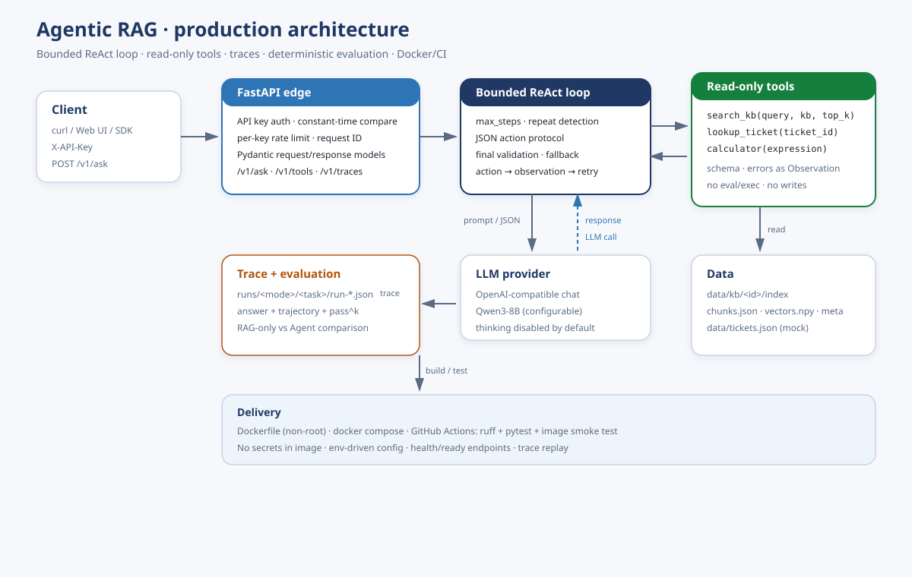

# Agentic RAG

> A bounded **ReAct agent** over a local RAG index, with read-only tools, traces,
> deterministic evaluation, and a FastAPI/Docker/CI production shell.




This is an **application-engineering** project, not a framework demo. It focuses on
the parts that decide whether an agent survives production:

- explicit tool contracts, error semantics, and read-only permissions;
- a bounded loop with stop conditions and repeat detection;
- a JSON action protocol that can be validated, replayed, and evaluated;
- per-step traces for debugging and regression analysis;
- a RAG-only baseline, so gains are attributable to tool orchestration;
- API-key auth, per-key rate limiting, Docker, and CI.

---

## Why this project

A single-turn RAG pipeline cannot answer a task like:

> “T-1001 涉及的报警应该怎么处理？”

It needs to look up the ticket first, then retrieve the alarm procedure. A calculator
task needs a calculator, not a language model doing mental arithmetic.

The reference evaluation (26 tasks, Qwen3-8B, `runs=1`) shows where the gain comes from:

| Mode | Task success | Tool selection | Avg steps | Avg latency | P95 |
| --- | --- | --- | --- | --- | --- |
| RAG-only | **18/26 = 69.2%** | — | 1.00 | **3.06s** | **5.72s** |
| Agent | **24/26 = 92.3%** | **100%** | 2.15 | 7.78s | 12.43s |
| Delta | **+23.1pp** | — | +1.15 | +4.72s | +6.71s |

`pass^3` on an 8-task representative subset: **6/8 = 75%**; after manually reviewing
one keyword false negative, **7/8 = 87.5%**.

The honest failures matter as much as the headline:

- **CA01** — the calculator returned `22.2`, but the model then emitted invalid JSON
  twice and hit `max_steps`; 3/3 runs failed. This is format fragility, not arithmetic.
- **KB05** — the answer was correct (“complementary; context utilization; lost in the
  middle”) but lacked the literal keyword “cost”, so the deterministic checker marked
  it wrong. Evaluation is a product, not a script.

Read the full analysis: [docs/evaluation.md](docs/evaluation.md).

---

## Quick start

### Docker (recommended)

```bash
cd AgenticRAG
cp .env.example .env
# edit .env: LLM_API_KEY + API_KEYS
docker compose up --build
```

Then:

```bash
curl -s localhost:8000/healthz
curl -s -H "X-API-Key: dev-key-change-me" localhost:8000/v1/tools
curl -s -X POST localhost:8000/v1/ask \
  -H "Content-Type: application/json" \
  -H "X-API-Key: dev-key-change-me" \
  -d '{"q":"T-1001 涉及的报警应该怎么处理？","kb":"dram"}'
```

OpenAPI docs: <http://localhost:8000/docs>.

### Local

```bash
cd AgenticRAG
python -m venv .venv
# Windows: .venv\Scripts\activate
source .venv/bin/activate
pip install -e ".[dev]"
cp .env.example .env
# edit .env
python -m agentic_rag demo          # replay traces, no API key needed
python -m agentic_rag demo --live   # real model calls
```

Ask one question:

```bash
python -m agentic_rag ask \
  --q "ALM-1042 报警的触发条件和处理步骤是什么？" \
  --kb dram --show-trace
```

Run the evaluation:

```bash
python -m agentic_rag eval --mode both --runs 1
# outputs: eval/report.json, eval/rag_report.md, eval/agent_report.md, eval/comparison.md
```

The bundled indexes were built with `BAAI/bge-m3` (1024-d). If you change
`EMB_MODEL`, rebuild the index or retrieval will fail on dimension mismatch.

---

## Demo

The repository ships three sanitized traces in `data/demo_traces/`:

| Trace | What it shows |
| --- | --- |
| `mx01_ticket_and_kb.json` | lookup ticket → search KB → final with citations |
| `tk01_ticket.json` | single tool call, no KB lookup |
| `ca01_format_failure.json` | calculator succeeds, then invalid JSON → max_steps |

```bash
# no API key required
./scripts/demo.sh          # macOS/Linux
.\scripts\demo.ps1         # Windows PowerShell
```

Add `--live` to run the same questions against the real model.

A 90-second interview demo script is in [docs/demo.md](docs/demo.md).

---

## API

All `/v1/*` endpoints require `X-API-Key`. If `API_KEYS` is empty, protected endpoints
return **503** rather than silently allowing anonymous access.

| Method | Path | Description |
| --- | --- | --- |
| GET | `/healthz` | liveness, no auth |
| GET | `/readyz` | data + LLM + API key readiness |
| GET | `/v1/tools` | tool catalog |
| POST | `/v1/ask` | run the bounded agent |
| GET | `/v1/traces/{trace_id}` | replay a trace |
| GET | `/v1/metrics` | process metrics |

Example response:

```json
{
  "trace_id": "9f6c...",
  "answerable": true,
  "answer": "处理 ALM-1042 的步骤如下：……",
  "citations": ["02_alarm_manual.md#0", "T-1001"],
  "missing": "",
  "steps": 3,
  "tools": ["lookup_ticket", "search_kb"],
  "latency_s": 12.4,
  "model": "Qwen/Qwen3-8B"
}
```

Error semantics:

| Status | Meaning |
| --- | --- |
| 401 | missing/invalid `X-API-Key` |
| 429 | per-key rate limit exceeded (`Retry-After`) |
| 503 | server has no `API_KEYS` or no LLM configuration |
| 400 | unknown `kb` or invalid trace id |
| 502 | upstream model/agent failure |

Full details: [docs/api.md](docs/api.md).

---

## Architecture

```text
Client (curl / UI / SDK)
  │  X-API-Key
  ▼
FastAPI edge: auth → per-key rate limit → request id
  │
  ▼
Bounded ReAct loop
  ├─ JSON action: {"thought","action","action_input"}
  ├─ validate action + args
  ├─ tools: search_kb | lookup_ticket | calculator
  ├─ observation → context → next step
  └─ final | max_steps | repeat detection
  │
  ├─ trace: runs/<mode>/<task>/run-*.json
  └─ eval: answer + trajectory + pass^k

Tools are read-only. Data is local. LLM is OpenAI-compatible.
```

See [docs/architecture.md](docs/architecture.md) for the Mermaid version and the
design rationale.

---

## Project layout

```text
AgenticRAG/
├── src/agentic_rag/
│   ├── api.py            FastAPI app, auth dependency, error handlers
│   ├── auth.py           constant-time API key check + rate limiter
│   ├── cli.py            ask / eval / demo / serve
│   ├── config.py         env-driven settings
│   ├── embeddings.py     bge-m3 client + offline hash baseline
│   ├── evaluation.py     deterministic answer + trajectory checks
│   ├── llm.py            OpenAI-compatible chat client
│   ├── loop.py           bounded ReAct loop, RAG-only baseline, traces
│   ├── prompts.py        action protocol + baseline prompt
│   ├── retrieval.py      BM25 + vectors + RRF/weighted fusion
│   ├── runtime.py        process wiring + metrics
│   ├── schemas.py        Pydantic request/response models
│   └── tools.py          tool registry + three read-only tools
├── data/
│   ├── kb/{dram,ai_prep,agent_eval}/{docs,index}
│   ├── tickets.json      mock tickets
│   ├── tasks.jsonl       26 evaluation tasks
│   └── demo_traces/      sanitized replay traces
├── docs/                 architecture, API, evaluation, production
├── tests/                pytest suite (no API calls)
├── scripts/              demo.sh / demo.ps1
├── Dockerfile
├── docker-compose.yml
├── pyproject.toml
└── .github/workflows/ci.yml
```

---

## Design decisions

| Decision | Why | Trade-off |
| --- | --- | --- |
| Hand-written loop, no LangGraph | Every state transition is explainable and testable | No built-in persistence/visualization |
| JSON action protocol | Portable across models; replayable and evaluable | Format fragility, needs validation/repair |
| One tool per step | Simple state machine and trace | No parallel tool calls |
| Read-only tools | Prompt injection cannot mutate state | Cannot “do” writes; production needs approval flow |
| Deterministic checks | Zero cost, reproducible | False negatives on paraphrase (see KB05) |
| RAG-only baseline | Isolates the value of tool orchestration | Baseline also costs one generation |
| In-memory rate limit | Simple, no extra infrastructure | Process-local; use Redis for multi-replica |

More: [docs/production.md](docs/production.md).

---

## Development

```bash
pip install -e ".[dev]"
ruff check src tests
pytest --cov=agentic_rag
```

CI runs the same checks on Python 3.11/3.12, plus a Docker image smoke test
(`/healthz`). The test suite uses a fake LLM and a fake API runner; **no credentials
or network calls are needed**.

Publishing this directory as its own repository: [docs/publishing.md](docs/publishing.md).
Security notes: [SECURITY.md](SECURITY.md).

---

## Limitations

- 26 tasks is a small evaluation set; results are for relative comparison, not a
  claim about production accuracy.
- Keyword checks are deterministic but can misjudge paraphrases; see KB05.
- Qwen3-8B sometimes emits invalid JSON after a tool call; CA01 documents this.
- Tools are read-only and operate on local mock data; there is no auth/ACL per
  document, no write approval flow, and no multi-tenant isolation.
- Rate limiting and metrics are in-process; use Redis/OpenTelemetry/API gateway in
  production.
- The bundled index requires an embedding provider at query time; there is no
  offline dense-search fallback.

## Roadmap

- [ ] LLM judge + human calibration for answer correctness
- [ ] structured output / JSON mode and a final-answer fallback
- [ ] per-document ACL and a human-approved write tool
- [ ] parallel read-only tool calls
- [ ] OpenTelemetry traces and a trace timeline UI
- [ ] MCP / function-calling adapter comparison
- [ ] 100+ task evaluation set with pass^k and failure taxonomy

---

## Data & license

The DRAM documents are illustrative examples written from public semiconductor
fundamentals; the tickets are mock data; the AI/Agent notes are personal study notes.
No proprietary or company data is included.

MIT License. See [LICENSE](LICENSE).
