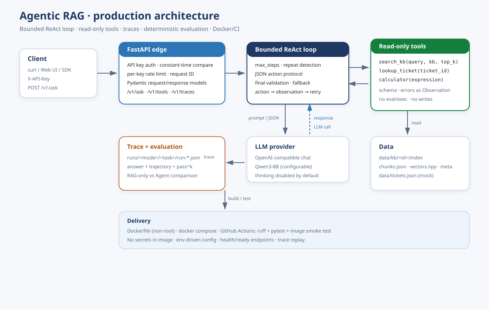
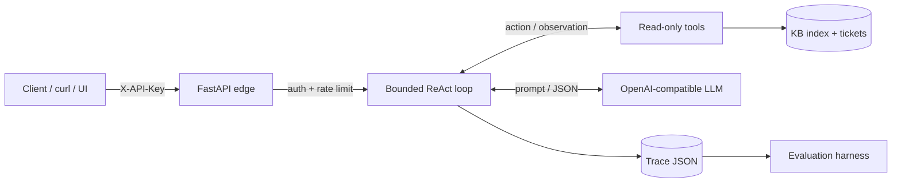

# Architecture



## Request lifecycle



1. The client sends `POST /v1/ask` with `X-API-Key`.
2. FastAPI validates the key, applies a per-key rate limit, and assigns a request id.
3. The agent builds a prompt from the tool catalog and the task.
4. The model returns one JSON action; the loop validates it and calls at most one tool.
5. The tool returns an Observation. Errors become Observations too, so the model can
   retry, switch tools, or finalize with a failure reason.
6. The loop stops on `final`, `max_steps`, repeated action, or an unrecoverable error.
7. A trace is written to `runs/agent/<trace_id>/run-1.json`; the response contains the
   answer, citations, step count, tool list, and latency.

## Why a bounded loop

The loop is deliberately small:

```python
for step in range(1, max_steps + 1):
    action = parse(llm(messages))
    if action == "final":
        return validate(action.input)
    observation = tools.call(action.name, action.input)
    messages += [assistant(action), user("Observation: " + observation)]
return fallback("max steps reached")
```

- **`max_steps`** is a hard budget, not a suggestion.
- **Repeat detection** rejects the same `(action, action_input)` after two calls.
- **Tool errors** are data, not crashes: the model sees `ERROR: ...` and can recover.
- **Final validation** requires `answer`, `answerable`, `citations`, and `missing`.
- **No hidden chain-of-thought** is stored; only a short `thought`, the action, and the
  observation are persisted.

## Tools

| Tool | Read-only | Why it exists | Failure contract |
| --- | --- | --- | --- |
| `search_kb` | yes | Hybrid retrieval over a bundled local index | unknown KB, empty query, index missing |
| `lookup_ticket` | yes | Join a ticket with its related alarm | unknown ticket returns `found:false` |
| `calculator` | pure | Arithmetic without model mental math | syntax, divide-by-zero, exponent limit |

The calculator uses an AST whitelist, not `eval`. The tools cannot write files, call
arbitrary URLs, or execute shell commands.

## RAG-only baseline

The baseline uses the same model and the same retriever, but only one retrieval and one
generation. It cannot call `lookup_ticket` or `calculator`. This isolates the value of
tool orchestration from “a better model” or “a better prompt”.

## Production shell

The FastAPI layer adds:

- constant-time API-key comparison and a fail-closed default;
- a per-key in-memory rate limiter (replace with Redis/API gateway for replicas);
- request IDs and response-time headers;
- `/healthz` and `/readyz` probes;
- `/v1/tools`, `/v1/ask`, `/v1/traces/{id}`, `/v1/metrics`;
- Pydantic request/response validation;
- Docker (non-root), compose, and GitHub Actions.

## Data layout

```text
data/
├── kb/<kb>/docs/       source documents
├── kb/<kb>/index/      chunks.json + vectors.npy + meta.json
├── tickets.json        mock tickets
├── tasks.jsonl         26 evaluation tasks
└── demo_traces/        replayable traces for the demo
```

The bundled index was built with `BAAI/bge-m3` (1024-d). Changing `EMB_MODEL` requires
rebuilding the index; the code does not mix vector spaces.
